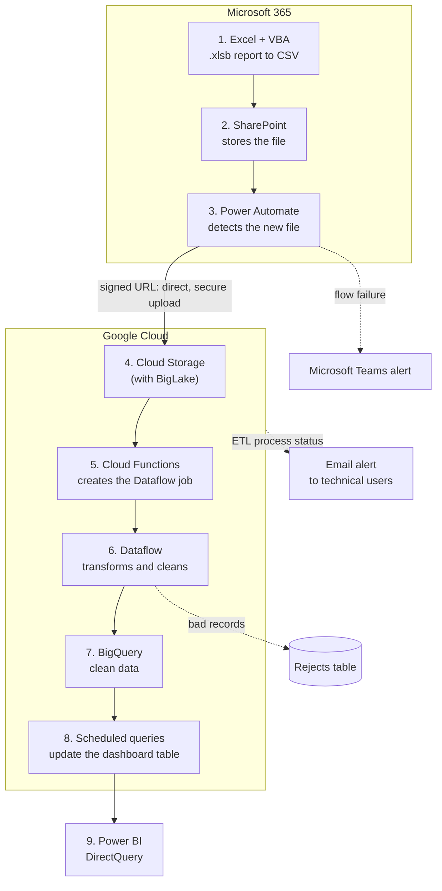
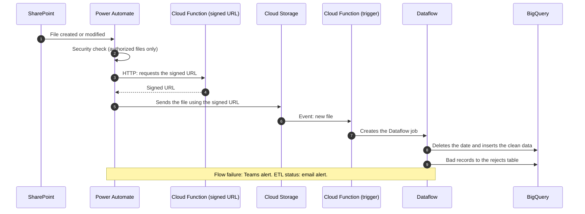

# Data pipeline on GCP: from SharePoint to BigQuery

> **Status:** implemented and verified · in production
> **Versión en español:** [README.md](README.md)
>
> **Scope of this repository:** documentation. The production code (Cloud Functions and Dataflow) lives in the company environment and processes internal data, so it is not published. This repository contains no data, credentials or internal folder or system names.

## 1. Executive summary

This pipeline automates the ingestion of an operational report generated **4 times a day**: it moves the report from SharePoint to **BigQuery** using Power Automate, Cloud Functions and Dataflow, controlling duplicates, sending bad records to a rejects table and emailing the process status. Scheduled queries keep up to date the table that a Power BI dashboard reads. It processes **150,000 records in 4 minutes** and runs in production at Cencosud.

## 2. The Problem — Context

- To analyze several years of data, the team built **Excel macros** that summarized the information in chunks, constrained by Excel's **1-million-row limit**. This took **between 2 days and 1 week**, depending on workload.
- Later a macro was created that reviewed each file and summarized it for analysis. The problem: when something went wrong, the **original file had to be found**, and reports were **often lost or deleted**.
- The pallet staging report is generated as `.xlsb` and refreshed **4 times a day**. The goal: store it in a structured way, with no manual steps and no duplicated records on each reload.

## 3. The Process — How I thought

| Decision | Why |
|---|---|
| Structured data in BigQuery instead of file-by-file summaries in Excel | When something fails it can be reviewed at detail level and no files are lost. |
| Power Automate as the trigger, uploading to Cloud Storage through a **signed URL** | Secure upload, straight to Cloud Storage. |
| **BigLake** on top of the bucket | Optimize storage costs. |
| Delete the date in BigQuery before inserting | The report arrives 4 times a day; this avoids duplicates. |
| A rejects table and an email alert | Bad records do not stop the load and can be reviewed. |

> **Pending:** technical alternatives evaluated within GCP and why they were discarded.

## 4. The Solution — What I solved

1. With VBA, the `.xlsb` report is converted to CSV and saved to SharePoint.
2. Power Automate detects the new file and sends it to the Cloud Storage bucket.
3. A Cloud Functions trigger fires on the file and runs a script that creates the Dataflow job.
4. **Dataflow** transforms and cleans the data: date formats, formula errors and per-column data types.
5. The date is deleted in BigQuery and the data is inserted; bad records go to the rejects table and the status is emailed.
6. Scheduled queries in BigQuery update the table connected to the Power BI dashboard, which reads it through DirectQuery.

**Status:** in production; it runs whenever new files are detected.

## 5. The Impact — Results and evidence

| Metric | Value | How it was measured |
|---|---|---|
| Records processed | **150,000 in 4 minutes** | From the Power Automate trigger to the end of processing in Cloud Functions. |
| Operational report processing | **from 2 hours to 15 minutes (−87%)** | End-to-end automation of the pipeline. |

**Qualitative (not measured):** the dashboard updates on its own, errors can be reviewed at detail level and no files are lost because everything is structured in BigQuery.

> **Pending:** analysis time with the pipeline versus the previous 2 days to 1 week.

## 6. Technical architecture

### Overview



### Ingestion sequence



### Components

| Component | Responsibility |
|---|---|
| Excel + VBA | Generates the `.xlsb` report and converts it to CSV. |
| SharePoint | Stores the file. |
| Power Automate | Detects the file, checks it is authorized, requests the signed URL and uploads the file. |
| Cloud Function (signed URL) | Returns the signed URL for the direct upload to Cloud Storage. |
| Cloud Storage + BigLake | Receives the CSV; BigLake optimizes storage costs. |
| Cloud Function (trigger) | Fires on the new file and runs the script that creates the Dataflow job. |
| Dataflow | Transforms and cleans the data and loads it into BigQuery. |
| BigQuery | Stores the data, the rejects table and the scheduled queries. |
| Power BI | Dashboard on BigQuery through DirectQuery. |

## 7. Data quality and testing

**Implemented:**

- Dataflow validates and fixes date formats, formula errors and per-column data types.
- Bad records go to a **rejects table** in BigQuery and do not stop the load.
- **Duplicate control:** each load deletes the matching date and inserts again, because the report arrives 4 times a day.
- The process status is emailed to the technical users.
- Security check in Power Automate: only authorized files continue.
- Microsoft Teams alert if the Power Automate flow fails.

> **Pending:** automated tests and additional validations to be documented.

## 8. Repository structure

```text
.
├── README.md        # Spanish version
└── README.en.md     # this document (English)
```

Proposed, not created yet: `docs/` with the exported diagrams and an example using synthetic data.

## 9. How to run

Not applicable: this repository is documentation only and contains no executable code. The production pipeline is deployed on Google Cloud and Microsoft Power Automate inside the company environment.

## 10. Limitations and future improvements

| Limitation | Proposed improvement |
|---|---|
| The production code is not public. | Build a reproducible version with synthetic data. |
| Tests and additional validations are undocumented. | Document the existing validations and add tests on synthetic data. |
| The technical alternatives evaluated are not documented. | Record the design decisions and their alternatives. |
| The analysis time versus the previous process has not been measured. | Measure the analysis time with the pipeline. |

## Feature status

| Feature | Status |
|---|---|
| CSV conversion and storage in SharePoint | Implemented and verified |
| Upload with Power Automate and a signed URL | Implemented and verified |
| Trigger Cloud Function and Dataflow job | Implemented and verified |
| Cleaning and duplicate-free load into BigQuery | Implemented and verified |
| Rejects table and email alert | Implemented and verified |
| Scheduled queries and Power BI dashboard | Implemented and verified |
| Automated tests | Unconfirmed |
| Reproducible version with synthetic data | Proposed / future |
