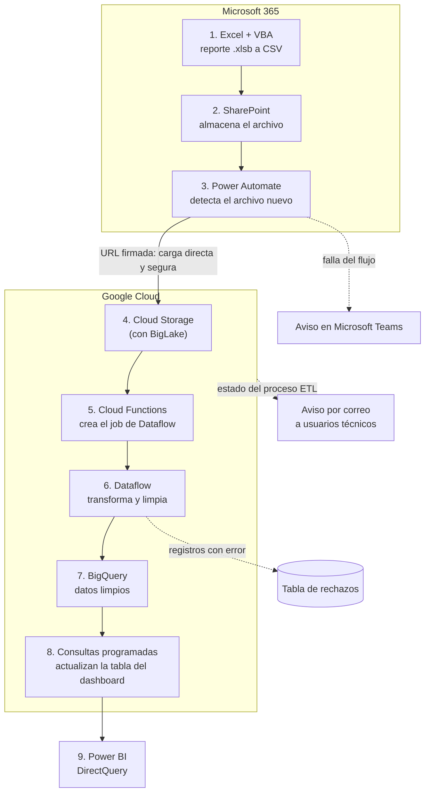
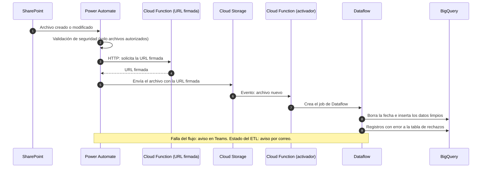

# Pipeline de datos en GCP: de SharePoint a BigQuery

> **Estado:** implementado y verificado · en producción
> **English version:** [README.en.md](README.en.md)
>
> **Alcance de este repositorio:** documentación. El código productivo (Cloud Functions y Dataflow) vive en el entorno de la empresa y procesa datos internos, por lo que no se publica. Este repositorio no contiene datos, credenciales ni nombres internos de carpetas o sistemas.

## 1. Resumen ejecutivo

Este pipeline automatiza la ingesta de un reporte operativo que se genera **4 veces al día**: lo lleva desde SharePoint hasta **BigQuery** con Power Automate, Cloud Functions y Dataflow, controlando duplicados, enviando los registros con error a una tabla de rechazos y avisando el estado por correo. Consultas programadas mantienen actualizada la tabla que consume un dashboard de Power BI. Procesa **150,000 registros en 4 minutos** y está en producción en Cencosud.

## 2. El Problema — El contexto

- Para analizar datos de varios años, el equipo armaba **macros de Excel** que resumían la información por partes, con el límite de **1 millón de filas** de Excel. Esto tomaba **entre 2 días y 1 semana**, según la carga de trabajo.
- Luego se creó una macro que revisaba cada archivo y lo resumía para analizarlo. El problema: ante un error había que **buscar el archivo original**, y los reportes **se perdían o se borraban** con frecuencia.
- El reporte de staging de paletas se genera en formato `.xlsb` y se actualiza **4 veces al día**. El objetivo: almacenarlo de forma estructurada, sin pasos manuales y sin duplicar registros en cada recarga.

## 3. El Proceso — Cómo pensé

| Decisión | Por qué |
|---|---|
| Datos estructurados en BigQuery en lugar de resúmenes archivo por archivo en Excel | Ante un error se revisa a nivel de detalle y no se pierden archivos. |
| Power Automate como disparador, con carga a Cloud Storage mediante **URL firmada** | Carga segura, directa a Cloud Storage. |
| **BigLake** sobre el bucket | Optimizar los costos de almacenamiento. |
| Borrar la fecha en BigQuery antes de insertar | El reporte llega 4 veces al día; así se evitan duplicados. |
| Una tabla de rechazos y aviso por correo | Los registros con error no detienen la carga y se pueden revisar. |

> **Pendiente:** alternativas técnicas evaluadas dentro de GCP y por qué se descartaron.

## 4. La Solución — Qué resolví

1. Con VBA, el reporte `.xlsb` se convierte a CSV y se guarda en SharePoint.
2. Power Automate detecta el archivo nuevo y lo envía al bucket de Cloud Storage.
3. Un disparador de Cloud Functions se activa con el archivo y ejecuta un script que crea el job de Dataflow.
4. **Dataflow** transforma y limpia los datos: formatos de fecha, errores provenientes de fórmulas y tipos de datos por columna.
5. Se elimina la fecha en BigQuery y se insertan los datos; los registros con error van a la tabla de rechazos y el estado se avisa por correo.
6. Consultas programadas en BigQuery actualizan la tabla conectada al dashboard de Power BI, que la consume vía DirectQuery.

**Estado:** en producción; se ejecuta cada vez que detecta archivos nuevos.

## 5. El Impacto — Resultados y evidencia

| Métrica | Valor | Cómo se midió |
|---|---|---|
| Registros procesados | **150,000 en 4 minutos** | Desde el disparo en Power Automate hasta el fin del procesamiento en Cloud Functions. |
| Procesamiento de reportes operativos | **de 2 horas a 15 minutos (−87 %)** | Automatización end-to-end del pipeline. |

**Cualitativo (no medido):** el dashboard se actualiza solo, los errores se revisan a nivel de detalle y no se pierden archivos porque todo queda estructurado en BigQuery.

> **Pendiente:** tiempo de análisis con el pipeline frente a los 2 días a 1 semana anteriores.

## 6. Arquitectura técnica

### Vista general



### Secuencia de la ingesta



### Componentes

| Componente | Responsabilidad |
|---|---|
| Excel + VBA | Genera el reporte `.xlsb` y lo convierte a CSV. |
| SharePoint | Almacena el archivo. |
| Power Automate | Detecta el archivo, valida que esté autorizado, pide la URL firmada y sube el archivo. |
| Cloud Function (URL firmada) | Entrega la URL firmada para la carga directa a Cloud Storage. |
| Cloud Storage + BigLake | Recibe el CSV; BigLake optimiza los costos de almacenamiento. |
| Cloud Function (activador) | Se activa con el archivo nuevo y ejecuta el script que crea el job de Dataflow. |
| Dataflow | Transforma y limpia los datos y los carga en BigQuery. |
| BigQuery | Almacena los datos, la tabla de rechazos y las consultas programadas. |
| Power BI | Dashboard sobre BigQuery vía DirectQuery. |

## 7. Calidad de datos y pruebas

**Implementado:**

- Dataflow valida y corrige formatos de fecha, errores provenientes de fórmulas y tipos de datos por columna.
- Los registros con error van a una **tabla de rechazos** en BigQuery y no detienen la carga.
- **Control de duplicados:** cada carga borra la fecha correspondiente e inserta de nuevo, porque el reporte llega 4 veces al día.
- El estado del proceso se avisa por correo a los usuarios técnicos.
- Validación de seguridad en Power Automate: solo continúan los archivos autorizados.
- Aviso en Microsoft Teams si falla el flujo de Power Automate.

> **Pendiente:** pruebas automatizadas y validaciones adicionales por documentar.

## 8. Estructura del repositorio

```text
.
├── README.md        # este documento (español)
└── README.en.md     # English version
```

Propuesto, aún no creado: `docs/` con los diagramas exportados y un ejemplo con datos sintéticos.

## 9. Cómo ejecutar

No aplica: este repositorio es documental y no contiene código ejecutable. El pipeline productivo se despliega en Google Cloud y en Microsoft Power Automate dentro del entorno de la empresa.

## 10. Limitaciones y mejoras futuras

| Limitación | Mejora propuesta |
|---|---|
| El código productivo no es público. | Crear una versión reproducible con datos sintéticos. |
| Pruebas y validaciones adicionales sin documentar. | Documentar las validaciones existentes y añadir pruebas sobre datos sintéticos. |
| No están documentadas las alternativas técnicas evaluadas. | Registrar las decisiones de diseño y sus alternativas. |
| No hay una medición del tiempo de análisis frente al proceso anterior. | Medir el tiempo de análisis con el pipeline. |

## Estado de las funcionalidades

| Funcionalidad | Estado |
|---|---|
| Conversión a CSV y almacenamiento en SharePoint | Implementado y verificado |
| Envío con Power Automate y URL firmada | Implementado y verificado |
| Cloud Function activadora y job de Dataflow | Implementado y verificado |
| Limpieza y carga a BigQuery sin duplicados | Implementado y verificado |
| Tabla de rechazos y aviso por correo | Implementado y verificado |
| Consultas programadas y dashboard de Power BI | Implementado y verificado |
| Pruebas automatizadas | No confirmado |
| Versión reproducible con datos sintéticos | Propuesto / futuro |
