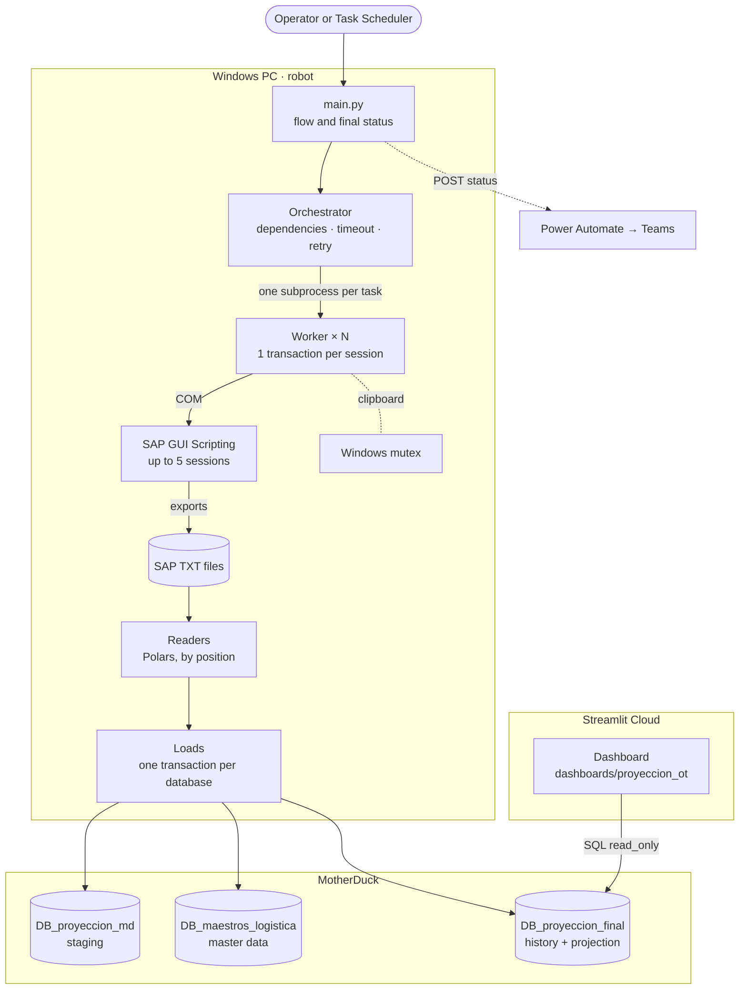
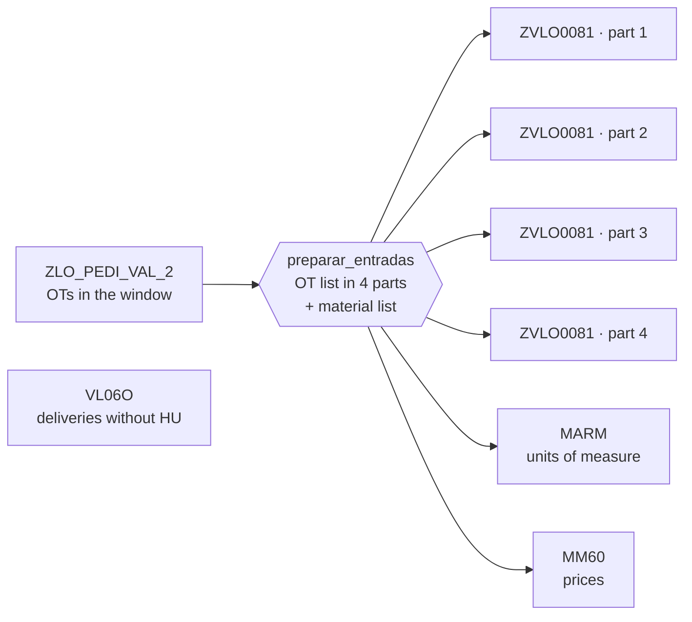

# Logistics OT Data Platform

Data pipeline that builds the **daily operational projection of transfer orders (OT)** for a distribution center. It downloads 7 SAP GUI reports across parallel sessions, loads them into **MotherDuck** (cloud DuckDB) with transactions and validations, and feeds a **Streamlit dashboard**.

`Python` · `Polars` · `DuckDB / MotherDuck` · `SQL` · `SAP GUI Scripting` · `Streamlit` · `Power Automate`

> Private repository: it contains business logic and internal names. Downloads, logs and tokens are never stored here.

**Versión en español:** [README.md](README.md)

---

## Contents

1. [Context](#context)
2. [What it does](#what-it-does)
3. [Architecture](#architecture)
4. [Parallel downloads](#parallel-downloads)
5. [MotherDuck tables](#motherduck-tables)
6. [Repository layout](#repository-layout)
7. [Requirements](#requirements)
8. [Installation and configuration](#installation-and-configuration)
9. [Usage](#usage)
10. [Tests](#tests)
11. [Technical decisions](#technical-decisions)
12. [Adding a new robot](#adding-a-new-robot)
13. [Known limitations](#known-limitations)

---

## Context

The distribution center needs to know every day how many OT lines must be prepared, what they are worth and what state they are in: **pending**, **delivery created** or already **processed** (with HU).

No report covered the whole flow. A team manually reviewed only the OTs with a delivery created, once a day and in about 30 minutes. This robot follows the full **OT → delivery → HU** flow.

| | Before (manual) | Now (RPA) |
|---|---|---|
| Scope | Only OTs with a delivery | OT → delivery → HU |
| Time per run | ~30 min | ~5 min |
| Frequency | Once a day | Several times a day |

<sub>Approximate values, estimated from day-to-day operation.</sub>

---

## What it does

| # | Stage | What happens | Code |
|---|---|---|---|
| 1 | SAP downloads | An orchestrator launches one subprocess per transaction, each on its own SAP GUI session (up to 5), respecting dependencies. | `comun/sap/`, `procesos/proyeccion_ot/transacciones.py` |
| 2 | Reading | Polars reads the TXT files by **column position** and casts types explicitly. | `comun/reportes_sap.py`, `procesos/proyeccion_ot/lectores.py` |
| 3 | Staging | Loads the date window into MotherDuck in **one transaction**. | `procesos/proyeccion_ot/cargas.py` |
| 4 | Complements | If adjustment days or master data are missing, downloads two extra reports. They are **optional**: if they fail, the run ends as `PARCIAL` (partial). | `procesos/proyeccion_ot/main.py` |
| 5 | Final projection | Updates the HU/delivery history, computes the projection with SQL (CTEs), marks closed OTs and **validates** the row count. | `procesos/proyeccion_ot/cargas.py` |
| 6 | Alert | Sends the status (`OK` / `PARCIAL` / `ERROR`) to Microsoft Teams via Power Automate. | `comun/notificacion.py` |

The dashboard (`dashboards/proyeccion_ot/`) connects to MotherDuck in **read-only** mode and only queries the final table.

---

## Architecture



---

## Parallel downloads



`ZLO_PEDI_VAL_2` and `VL06O` start together. Once `ZLO_PEDI_VAL_2` finishes, the rest launch as soon as a session is free, at least 15 s apart.

| Task | Transaction | Input | Depends on | Max time | Required |
|---|---|---|---|---|---|
| `ZLO_PEDI_VAL_2` | SQ01 `ZLO_PEDI_VAL_2` | Date window | — | 20 min | Yes |
| `VL06O` | `VL06O` | — | — | 20 min | Yes |
| `ZVLO0081_parte_1..4` | `ZVLO0081` | ¼ of the OT list | `ZLO_PEDI_VAL_2` | 30 min | Yes |
| `MARM` | SQ01 `ZLO_MARM` | Materials | `ZLO_PEDI_VAL_2` | 10 min | Yes |
| `MM60` | `MM60` | Materials | `ZLO_PEDI_VAL_2` | 10 min | Yes |
| `FENTRE` | SQ01 `ZLO_RPT_FENTRE` | OTs without adjustment days | Staging | 10 min | No |
| `ZVAB0006` | `ZVAB0006` | Materials without master data | Staging | 10 min | No |

Each task gets **1 retry**, and the retry uses a different session. If a required task fails twice, the orchestrator stops every worker and the run ends as `ERROR`.

---

## MotherDuck tables

| Database | Table | Content |
|---|---|---|
| `DB_proyeccion_md` | `proyectado` | OT lines in the date window |
| | `MARM` | Alternative units of measure |
| | `MM60` | Prices |
| | `cfg_ajuste_fecha_entrega` | Adjustment days per store and material |
| `DB_maestros_logistica` | `dim_maestro_logistica` | Material master: brand, supplier, management unit, business unit |
| | `dim_establecimiento` | Stores and region |
| `DB_proyeccion_final` | `historial_modulacion_ot` | Delivery and HU history per OT |
| | `proyeccion_operativa_diaria_2` | **Final table**: one row per OT line, with amount, adjusted date, management unit and status |

Names are defined in `procesos/proyeccion_ot/config.py`. Every query uses the fully qualified name (`database.table`), because the `md:` connection does not set a default database.

---

## Repository layout

```text
logistics-ot-data-platform/
├── comun/                        code reusable by any robot
│   ├── entorno.py                project root, .env, base folders, defaults
│   ├── registro.py               logging to console and file
│   ├── archivos.py               lists for SAP and splitting into parts
│   ├── candados.py               Windows mutex between processes
│   ├── motherduck.py             connection with a transaction (COMMIT / ROLLBACK)
│   ├── notificacion.py           Teams alert (Power Automate)
│   ├── reportes_sap.py           reads SAP TXT files by column position
│   └── sap/
│       ├── conexion.py           SAP sessions, cleanup, clipboard paste
│       ├── orquestador.py        parallel subprocesses: dependencies, timeouts, retries
│       └── worker.py             runs ONE transaction on one session
├── procesos/                     one robot per folder
│   └── proyeccion_ot/
│       ├── main.py               robot flow
│       ├── config.py             date window, sessions, timeouts, tables
│       ├── transacciones.py      recorded SAP steps + TRANSACCIONES registry
│       ├── lectores.py           SAP TXT → DataFrames
│       └── cargas.py             staging, complements and final projection
├── dashboards/                   one dashboard per folder, each with its own requirements.txt
│   └── proyeccion_ot/
│       ├── app.py                entry point (the one Streamlit Cloud uses)
│       ├── consultas.py          token, read-only connection and cached queries
│       ├── graficos.py           Plotly charts
│       ├── componentes.py        CSS and HTML pieces
│       ├── configuracion.py      table, columns, palette and parameters
│       └── .streamlit/config.toml
├── tests/                        tests without SAP (python -m tests)
├── herramientas/                 .exe build
├── requirements.txt              robot dependencies
└── .env                          tokens (never committed)
```

Downloads and logs are stored **outside the repository**, in one subfolder per process. The base paths are defined in `comun/entorno.py` (`CARPETA_DESCARGAS_BASE`, `CARPETA_LOGS_BASE`). Logs older than 30 days are deleted automatically.

---

## Requirements

- **Windows** with **SAP GUI** and scripting enabled (client and server), with a session already logged in.
- **Python 3.10 or later**.
- A **MotherDuck** account and token.
- **Protected SAP variants**: reports are read by column position (see [Known limitations](#known-limitations)).

Robot dependencies (`requirements.txt`): `duckdb`, `polars`, `pyarrow`, `pyperclip`, `pywin32`, `python-dotenv`, `requests`.
Dashboard dependencies (`dashboards/proyeccion_ot/requirements.txt`): `streamlit`, `duckdb`, `pandas`, `pyarrow`, `plotly`, `python-dotenv`.

---

## Installation and configuration

```powershell
python -m venv ent_virtual
ent_virtual\Scripts\python.exe -m pip install -r requirements.txt
```

Create a `.env` file in the root:

```dotenv
TOKEN_MOTHERDUCK=<token with write access>
API_Power_Automate=<Power Automate HTTP flow URL>
```

On **Streamlit Cloud**, set `TOKEN_MOTHERDUCK` in the app's *Secrets*. It should be a **read-only** token, separate from the one the robot uses.

Main parameters:

| Parameter | File | Value | Purpose |
|---|---|---|---|
| `DIAS_ATRAS` / `DIAS_ADELANTE` | `config.py` | 7 / 7 | Delivery date window recalculated on each run |
| `SESIONES_SAP` | `config.py` | 5 | Sessions the robot uses (SAP usually allows 6 per user) |
| `PARTES_ZVLO0081` | `config.py` | 4 | Number of parts the OT list is split into |
| `TIMEOUT_TAREA_SEG` | `config.py` | per transaction | Time limit before the subprocess is stopped |
| `NOTIFICAR_TEAMS` | `config.py` | `False` | Enables the Teams alert; set it to `True` in production |
| `INTERVALO_LANZAMIENTO_SEG` | `entorno.py` | 15 | Minimum pause between launches |
| `REINTENTOS_TAREA` | `entorno.py` | 1 | Retries per SAP task |
| `ESPERA_PORTAPAPELES_SEG` | `entorno.py` | 180 | Maximum wait to acquire the clipboard |

---

## Usage

From the root, with the virtual environment:

| Action | Command |
|---|---|
| Run the robot | `ent_virtual\Scripts\python.exe -m procesos.proyeccion_ot` |
| Run the dashboard locally | `ent_virtual\Scripts\streamlit.exe run dashboards/proyeccion_ot/app.py` |
| Run the tests | `ent_virtual\Scripts\python.exe -m tests` |
| Build the .exe | `powershell -ExecutionPolicy Bypass -File herramientas\compilar_exe_proyeccion_ot.ps1` |

**Exit codes** (useful for Windows Task Scheduler):

| Code | Meaning |
|---|---|
| `0` | `OK`, or `PARCIAL` if an optional complement failed |
| `1` | `ERROR`: a required stage failed |
| `2` | Another robot is already using SAP; the run is cancelled |

> **Important:** the `.exe` bundles the `.env` file with the tokens. Do not share it outside the team.

Do not use the machine while the robot is downloading: the clipboard is shared with the user, and the robot takes the first SAP sessions, including the one you may have open.

---

## Tests

```powershell
ent_virtual\Scripts\python.exe -m tests
```

Runs 3 scripts with **43 cases** in total, without connecting to SAP or MotherDuck:

| Script | What it tests |
|---|---|
| `probar_orquestador.py` | Splitting OTs into parts, dependencies, session limit, retry on another session, timeouts, abort with process cleanup, optional tasks and large output without blocking. Uses a fake worker (`falso_worker.py`). |
| `probar_candados_y_job.py` | Mutex between processes, release when the owner dies, Windows Job and clipboard paste. |
| `probar_cargas_local.py` | All the SQL against a **local DuckDB** with the same schema: idempotency, ROLLBACK on errors, row-count validation, statuses and `ot_cerrada`. |

Notes:
- The tests need Windows (mutex, Windows Job and `tasklist`).
- `probar_cargas_local.py` uses the TXT files from the latest download, so it needs at least one previous robot run.

---

## Technical decisions

- **Processes, not threads.** SAP GUI Scripting is COM, and multithreaded COM in Python is fragile. Each worker has its own connection and log, and a stuck worker can be stopped without affecting the rest.
- **Windows Job.** Workers are created suspended and assigned to a Job with `KILL_ON_JOB_CLOSE` before they resume. If the robot dies, its workers die too.
- **Reading by position.** Header names change in SAP (language, version); positions are fixed by protected variants.
- **Text first.** TXT files are read as text and types are cast explicitly, so values like `"00010"` or `"1,234.500-"` are never misread.
- **One transaction per database.** Everything loads or nothing does; besides, in MotherDuck a transaction can only write to one database.
- **Idempotent loads.** The window is deleted and inserted again, or only new records are inserted (`NOT EXISTS`). Retrying never duplicates data.
- **`INSERT … BY NAME`.** Columns are matched by name, not by position.
- **Final validation.** If the projection row count does not match `proyectado`, a JOIN duplicated lines: `ErrorValidacion` is raised and everything is rolled back.
- **Named SQL parameters** (`$inicio`, `$fin`). Values are never concatenated into SQL text.
- **Secrets outside the code.** Tokens are read from `.env` or from Streamlit *Secrets*.

---

## Adding a new robot

1. Create `procesos/<name>/` with `__init__.py`, `config.py`, `transacciones.py`, `lectores.py`, `cargas.py` and `main.py`. You can copy the `proyeccion_ot` layout.
2. In `transacciones.py`, register each download: `TRANSACCIONES = {"NAME": (function, uses_input, uses_dates)}`.
3. In `config.py`, set `MODULO_TRANSACCIONES = "procesos.<name>.transacciones"`.
4. `comun/` never imports from `procesos/`. The worker loads transactions by name with `importlib`, so it needs no changes.
5. Only one robot uses SAP at a time (lock `RPA_SAP_en_uso`); the clipboard has its own lock (`RPA_portapapeles`).

---

## Known limitations

- **Reading by position.** If someone changes the column order in a variant, data lands in the wrong column **with no error**. The defenses are protected variants and type casting.
- **Shared clipboard.** The lock protects workers from each other, but not from a user pressing Ctrl+C during downloads.
- **Timeout ≠ report finished.** Stopping a worker does not stop the report on the SAP server; that session may stay busy and use up a retry.
- **Non-SAP windows.** A Windows dialog (for example "SAP GUI Security") is not closed by F12: the task waits until its timeout.
- **The history grows without limit.** `historial_modulacion_ot` accumulates rows from every run. Pending: a retention policy.
- **Strict validation can block a load.** If the master data or MARM bring duplicates, the whole final load is rolled back, and the dashboard is not updated that day until the data is fixed.
- **Internal APIs.** `proceso._handle` and `NtResumeProcess` work today but could change in future Python or Windows versions. If they fail, the robot keeps working, just without the Job protection.
