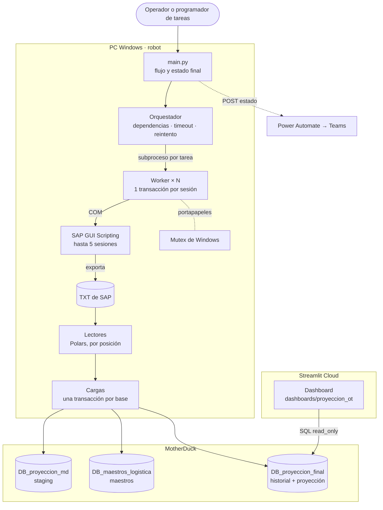
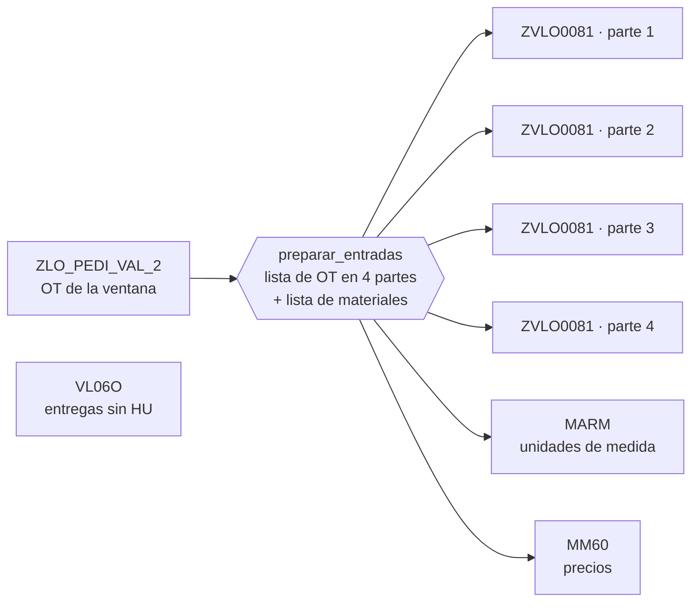

# Logistics OT Data Platform

Pipeline de datos que genera la **proyección operativa diaria de órdenes de traslado (OT)** de un centro de distribución. Descarga 7 reportes de SAP GUI en sesiones paralelas, los carga en **MotherDuck** (DuckDB en la nube) con transacciones y validaciones, y alimenta un **dashboard en Streamlit**.

`Python` · `Polars` · `DuckDB / MotherDuck` · `SQL` · `SAP GUI Scripting` · `Streamlit` · `Power Automate`

> Repositorio privado: contiene lógica de negocio y nombres internos. Las descargas, los logs y los tokens nunca se guardan aquí.

**English version:** [README.en.md](README.en.md)

---

## Índice

1. [Contexto](#contexto)
2. [Qué hace](#qué-hace)
3. [Arquitectura](#arquitectura)
4. [Descargas en paralelo](#descargas-en-paralelo)
5. [Tablas en MotherDuck](#tablas-en-motherduck)
6. [Estructura del repositorio](#estructura-del-repositorio)
7. [Requisitos](#requisitos)
8. [Instalación y configuración](#instalación-y-configuración)
9. [Uso](#uso)
10. [Pruebas](#pruebas)
11. [Decisiones técnicas](#decisiones-técnicas)
12. [Agregar un robot nuevo](#agregar-un-robot-nuevo)
13. [Limitaciones conocidas](#limitaciones-conocidas)

---

## Contexto

El centro de distribución necesita saber cada día cuántas líneas de OT hay que preparar, cuánto valen y en qué estado están: **pendientes**, con **entrega generada** o ya **trabajadas** (con HU).

No existía un reporte que cubriera todo el flujo. Un equipo revisaba a mano solo las OT con entrega generada, una vez al día y en unos 30 minutos. Este robot sigue el flujo completo **OT → entrega → HU**.

| | Antes (manual) | Ahora (RPA) |
|---|---|---|
| Alcance | Solo OT con entrega | OT → entrega → HU |
| Tiempo por ejecución | ~30 min | ~5 min |
| Frecuencia | 1 vez al día | Varias veces al día |

<sub>Valores aproximados, estimados a partir de la operación diaria.</sub>

---

## Qué hace

| # | Etapa | Qué ocurre | Código |
|---|---|---|---|
| 1 | Descargas SAP | Un orquestador lanza un subproceso por transacción, cada uno en su propia sesión de SAP GUI (hasta 5), respetando dependencias. | `comun/sap/`, `procesos/proyeccion_ot/transacciones.py` |
| 2 | Lectura | Polars lee los TXT por **posición de columna** y convierte los tipos de forma explícita. | `comun/reportes_sap.py`, `procesos/proyeccion_ot/lectores.py` |
| 3 | Staging | Carga la ventana de fechas en MotherDuck en **una transacción**. | `procesos/proyeccion_ot/cargas.py` |
| 4 | Complementos | Si faltan días de ajuste o datos maestros, descarga dos reportes extra. Son **opcionales**: si fallan, el resultado queda `PARCIAL`. | `procesos/proyeccion_ot/main.py` |
| 5 | Proyección final | Actualiza el historial de modulación, calcula la proyección con SQL (CTEs), marca las OT cerradas y **valida** el conteo de filas. | `procesos/proyeccion_ot/cargas.py` |
| 6 | Aviso | Envía el estado (`OK` / `PARCIAL` / `ERROR`) a Microsoft Teams vía Power Automate. | `comun/notificacion.py` |

El dashboard (`dashboards/proyeccion_ot/`) se conecta a MotherDuck en **solo lectura** y consulta únicamente la tabla final.

---

## Arquitectura



---

## Descargas en paralelo



`ZLO_PEDI_VAL_2` y `VL06O` arrancan juntas. Al terminar `ZLO_PEDI_VAL_2`, el resto se lanza en cuanto hay una sesión libre, con al menos 15 s entre lanzamientos.

| Tarea | Transacción | Entrada | Depende de | Tiempo máx. | Obligatoria |
|---|---|---|---|---|---|
| `ZLO_PEDI_VAL_2` | SQ01 `ZLO_PEDI_VAL_2` | Ventana de fechas | — | 20 min | Sí |
| `VL06O` | `VL06O` | — | — | 20 min | Sí |
| `ZVLO0081_parte_1..4` | `ZVLO0081` | ¼ de la lista de OT | `ZLO_PEDI_VAL_2` | 30 min | Sí |
| `MARM` | SQ01 `ZLO_MARM` | Materiales | `ZLO_PEDI_VAL_2` | 10 min | Sí |
| `MM60` | `MM60` | Materiales | `ZLO_PEDI_VAL_2` | 10 min | Sí |
| `FENTRE` | SQ01 `ZLO_RPT_FENTRE` | OT sin días de ajuste | Staging | 10 min | No |
| `ZVAB0006` | `ZVAB0006` | Materiales sin maestro | Staging | 10 min | No |

Cada tarea tiene **1 reintento**, y el reintento usa otra sesión. Si una tarea obligatoria falla dos veces, el orquestador detiene a todos los workers y la ejecución termina en `ERROR`.

---

## Tablas en MotherDuck

| Base | Tabla | Contenido |
|---|---|---|
| `DB_proyeccion_md` | `proyectado` | Líneas de OT de la ventana de fechas |
| | `MARM` | Unidades de medida alternativas |
| | `MM60` | Precios |
| | `cfg_ajuste_fecha_entrega` | Días de ajuste por tienda y material |
| `DB_maestros_logistica` | `dim_maestro_logistica` | Maestro de materiales: marca, proveedor, gerencia, unidad de negocio |
| | `dim_establecimiento` | Tiendas y región |
| `DB_proyeccion_final` | `historial_modulacion_ot` | Historial de entregas y HU por OT |
| | `proyeccion_operativa_diaria_2` | **Tabla final**: una fila por línea de OT, con importe, fecha ajustada, gerencia y estado |

Los nombres se definen en `procesos/proyeccion_ot/config.py`. Todas las consultas usan el nombre completo (`base.tabla`), porque la conexión `md:` no fija una base por defecto.

---

## Estructura del repositorio

```text
logistics-ot-data-platform/
├── comun/                        código reutilizable por cualquier robot
│   ├── entorno.py                raíz del proyecto, .env, carpetas base, valores por defecto
│   ├── registro.py               logs a consola y archivo
│   ├── archivos.py               listas para SAP y reparto en partes
│   ├── candados.py               mutex de Windows entre procesos
│   ├── motherduck.py             conexión con transacción (COMMIT / ROLLBACK)
│   ├── notificacion.py           aviso a Teams (Power Automate)
│   ├── reportes_sap.py           lectura de TXT de SAP por posición de columna
│   └── sap/
│       ├── conexion.py           sesiones SAP, limpieza, pegado por portapapeles
│       ├── orquestador.py        subprocesos en paralelo: dependencias, timeouts, reintentos
│       └── worker.py             ejecuta UNA transacción en una sesión
├── procesos/                     un robot por carpeta
│   └── proyeccion_ot/
│       ├── main.py               flujo del robot
│       ├── config.py             ventana de fechas, sesiones, timeouts, tablas
│       ├── transacciones.py      pasos grabados de SAP + registro TRANSACCIONES
│       ├── lectores.py           TXT de SAP → DataFrames
│       └── cargas.py             staging, complementos y proyección final
├── dashboards/                   un dashboard por carpeta, cada uno con su requirements.txt
│   └── proyeccion_ot/
│       ├── app.py                archivo principal (el que usa Streamlit Cloud)
│       ├── consultas.py          token, conexión de solo lectura y consultas con caché
│       ├── graficos.py           gráficos Plotly
│       ├── componentes.py        CSS y piezas HTML
│       ├── configuracion.py      tabla, columnas, paleta y parámetros
│       └── .streamlit/config.toml
├── tests/                        pruebas sin SAP (python -m tests)
├── herramientas/                 compilación del .exe
├── requirements.txt              dependencias del robot
└── .env                          tokens (no se sube a Git)
```

Las descargas y los logs se guardan **fuera del repositorio**, en una subcarpeta por proceso. Las rutas base se definen en `comun/entorno.py` (`CARPETA_DESCARGAS_BASE`, `CARPETA_LOGS_BASE`). Los logs de más de 30 días se borran solos.

---

## Requisitos

- **Windows** con **SAP GUI** y el scripting habilitado (cliente y servidor), con la sesión ya iniciada.
- **Python 3.10 o superior**.
- Una cuenta de **MotherDuck** con su token.
- Las **variantes de SAP protegidas**: los reportes se leen por posición de columna (ver [Limitaciones](#limitaciones-conocidas)).

Dependencias del robot (`requirements.txt`): `duckdb`, `polars`, `pyarrow`, `pyperclip`, `pywin32`, `python-dotenv`, `requests`.
Dependencias del dashboard (`dashboards/proyeccion_ot/requirements.txt`): `streamlit`, `duckdb`, `pandas`, `pyarrow`, `plotly`, `python-dotenv`.

---

## Instalación y configuración

```powershell
python -m venv ent_virtual
ent_virtual\Scripts\python.exe -m pip install -r requirements.txt
```

Crea un archivo `.env` en la raíz:

```dotenv
TOKEN_MOTHERDUCK=<token con permiso de escritura>
API_Power_Automate=<URL del flujo HTTP de Power Automate>
```

En **Streamlit Cloud**, configura `TOKEN_MOTHERDUCK` en la sección *Secrets* de la app. Conviene que sea un token de **solo lectura**, distinto del que usa el robot.

Parámetros principales:

| Parámetro | Archivo | Valor | Para qué |
|---|---|---|---|
| `DIAS_ATRAS` / `DIAS_ADELANTE` | `config.py` | 7 / 7 | Ventana de fechas de entrega que se recalcula |
| `SESIONES_SAP` | `config.py` | 5 | Sesiones que usa el robot (SAP suele permitir 6 por usuario) |
| `PARTES_ZVLO0081` | `config.py` | 4 | Partes en que se reparte la lista de OT |
| `TIMEOUT_TAREA_SEG` | `config.py` | por transacción | Tiempo máximo antes de detener el subproceso |
| `NOTIFICAR_TEAMS` | `config.py` | `False` | Activa el aviso a Teams; ponlo en `True` en producción |
| `INTERVALO_LANZAMIENTO_SEG` | `entorno.py` | 15 | Pausa mínima entre lanzamientos |
| `REINTENTOS_TAREA` | `entorno.py` | 1 | Reintentos por tarea SAP |
| `ESPERA_PORTAPAPELES_SEG` | `entorno.py` | 180 | Espera máxima para tomar el portapapeles |

---

## Uso

Desde la raíz, con el entorno virtual:

| Acción | Comando |
|---|---|
| Ejecutar el robot | `ent_virtual\Scripts\python.exe -m procesos.proyeccion_ot` |
| Ver el dashboard en local | `ent_virtual\Scripts\streamlit.exe run dashboards/proyeccion_ot/app.py` |
| Ejecutar las pruebas | `ent_virtual\Scripts\python.exe -m tests` |
| Compilar el .exe | `powershell -ExecutionPolicy Bypass -File herramientas\compilar_exe_proyeccion_ot.ps1` |

**Códigos de salida** (útiles para el Programador de tareas):

| Código | Significado |
|---|---|
| `0` | `OK`, o `PARCIAL` si falló un complemento opcional |
| `1` | `ERROR`: falló una etapa obligatoria |
| `2` | Otro robot ya está usando SAP; la ejecución se cancela |

> **Importante:** el `.exe` incluye el `.env` con los tokens. No lo compartas fuera del equipo.

Mientras el robot descarga, no uses el equipo: el portapapeles se comparte con el usuario, y el robot toma las primeras sesiones de SAP, incluida la que tengas abierta.

---

## Pruebas

```powershell
ent_virtual\Scripts\python.exe -m tests
```

Ejecuta 3 scripts con **43 casos** en total, sin conectarse a SAP ni a MotherDuck:

| Script | Qué prueba |
|---|---|
| `probar_orquestador.py` | Reparto de OT en partes, dependencias, límite de sesiones, reintento en otra sesión, timeouts, aborto con limpieza de procesos, tareas opcionales y salida grande sin bloqueo. Usa un worker simulado (`falso_worker.py`). |
| `probar_candados_y_job.py` | Mutex entre procesos, liberación si el dueño muere, Job de Windows y pegado por portapapeles. |
| `probar_cargas_local.py` | Todo el SQL contra una **DuckDB local** con el mismo esquema: idempotencia, ROLLBACK ante errores, validación de conteo, estados y `ot_cerrada`. |

Notas:
- Las pruebas necesitan Windows (mutex, Job de Windows y `tasklist`).
- `probar_cargas_local.py` usa los TXT de la última descarga, así que necesita al menos una ejecución previa del robot.

---

## Decisiones técnicas

- **Procesos en lugar de hilos.** SAP GUI Scripting es COM, y COM con varios hilos en Python es delicado. Cada worker tiene su propia conexión y su propio log, y si se cuelga se puede detener sin afectar a los demás.
- **Job de Windows.** Los workers se crean suspendidos y se asignan a un Job con `KILL_ON_JOB_CLOSE` antes de reanudarlos. Si el robot muere, mueren sus workers.
- **Lectura por posición.** Los nombres de los encabezados cambian en SAP (idioma, versión); las posiciones están fijadas en variantes protegidas.
- **Todo como texto primero.** Los TXT se leen como texto y los tipos se convierten de forma explícita, para que `"00010"` o `"1,234.500-"` no se interpreten mal.
- **Una transacción por base.** O se carga todo o nada; además, en MotherDuck una transacción solo puede escribir en una base.
- **Cargas idempotentes.** Se borra la ventana y se inserta de nuevo, o se insertan solo los registros nuevos (`NOT EXISTS`). Reintentar no duplica datos.
- **`INSERT … BY NAME`.** Las columnas se emparejan por nombre, no por posición.
- **Validación final.** Si las filas de la proyección no coinciden con las de `proyectado`, algún JOIN duplicó líneas: se lanza `ErrorValidacion` y se revierte todo.
- **Parámetros con nombre en SQL** (`$inicio`, `$fin`). Nunca se concatenan valores en el texto SQL.
- **Secretos fuera del código.** Los tokens se leen desde `.env` o desde los *Secrets* de Streamlit.

---

## Agregar un robot nuevo

1. Crea `procesos/<nombre>/` con `__init__.py`, `config.py`, `transacciones.py`, `lectores.py`, `cargas.py` y `main.py`. Puedes copiar la estructura de `proyeccion_ot`.
2. En `transacciones.py`, registra cada descarga: `TRANSACCIONES = {"NOMBRE": (funcion, usa_entrada, usa_fechas)}`.
3. En `config.py`, define `MODULO_TRANSACCIONES = "procesos.<nombre>.transacciones"`.
4. `comun/` nunca importa nada de `procesos/`. El worker carga las transacciones por nombre con `importlib`, así que no hay que modificarlo.
5. Solo un robot usa SAP a la vez (candado `RPA_SAP_en_uso`); el portapapeles tiene su propio candado (`RPA_portapapeles`).

---

## Limitaciones conocidas

- **Lectura por posición.** Si alguien cambia el orden de columnas en una variante, los datos se cargan en la columna equivocada **sin error**. La defensa son las variantes protegidas y la conversión de tipos.
- **Portapapeles compartido.** El candado protege entre workers, pero no frente a un Ctrl+C del usuario durante las descargas.
- **Timeout ≠ fin del reporte.** Detener un worker no detiene el reporte en el servidor SAP; esa sesión puede quedar ocupada y consumir un reintento.
- **Ventanas que no son de SAP.** Un diálogo de Windows (por ejemplo, "SAP GUI Security") no se cierra con F12: la tarea espera hasta su timeout.
- **El historial crece sin límite.** `historial_modulacion_ot` acumula filas de todas las ejecuciones. Pendiente: definir una política de retención.
- **Una validación estricta puede frenar la carga.** Si el maestro o MARM traen duplicados, se revierte toda la carga final y ese día el dashboard no se actualiza hasta corregir el dato.
- **APIs internas.** `proceso._handle` y `NtResumeProcess` funcionan hoy, pero podrían cambiar con nuevas versiones de Python o Windows. Si fallan, el robot sigue funcionando, solo que sin la protección del Job.
