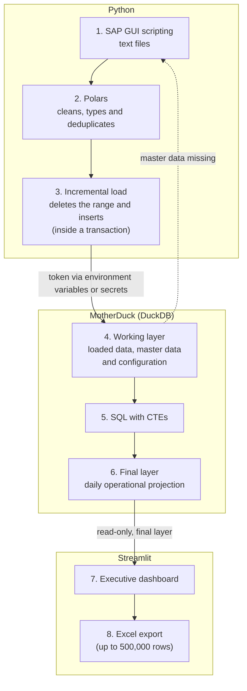

# Logistics data platform with DuckDB / MotherDuck and Streamlit

> **Status:** implemented, used by the Non Food and Supply Chain management · formal validation pending
> **Versión en español:** [README.md](README.md)

## 1. Executive summary

This project turns logistics data extracted from SAP into a **daily operational projection** for distribution centers and serves it in an **executive dashboard**. Python and Polars extract and clean the data, **MotherDuck (DuckDB in the cloud)** stores it in two layers, and **Streamlit** consumes it. It is used today by the Non Food and Supply Chain management; there are no measured impact metrics yet.

## 2. The Problem — Context

- Logistics data lives in several operational sources: SAP plus master and configuration tables.
- The need: a reliable daily projection and a clear view of what has been **generated versus what is still pending**.
- **There was no previous report.** It was going to be built as an Excel VBA macro.
- Business constraint: the **history of every order** has to be known, which a set of Excel files does not handle well.

## 3. The Process — How I thought

| Decision | Why |
|---|---|
| A database instead of an Excel VBA macro | The history of every order was needed; a database is a better fit than Excel files. |
| MotherDuck | I already knew DuckDB. Besides working as a data warehouse, it can build dashboards with *Dives*. I plan to learn more about *Flights*. |
| Two layers: working and final | The dashboard only reads the final layer, which separates processing from consumption. |
| Incremental load by date range, inside a transaction | Lets a range be reloaded without duplicates and rolled back if anything fails. |
| Automatic detection of missing master data | If master data is missing, the process downloads it from SAP and completes the working layer. |
| Token kept out of the code | It is read from environment variables or secrets and is never committed to the repository. |

## 4. The Solution — What I solved

1. **Extraction:** SAP GUI scripting downloads text files (projected orders, prices and material master).
2. **Cleaning:** Polars cleans, renames, types and deduplicates the data.
3. **Loading:** the data is loaded into MotherDuck incrementally by date range, inside a transaction.
4. **Modeling:** a SQL query with CTEs builds the final daily operational projection table (units of measure, amounts, delivery date adjustment, business unit and management unit).
5. **Consumption:** a Streamlit dashboard reads the final table and shows KPIs, generated vs. pending, daily/weekly/monthly pace, cumulative gap, breakdowns by management and business unit, filters and Excel export.

**Responsibilities:** the engineering pipeline (SAP → Polars → MotherDuck) produces the data; the dashboard **only consumes** the final layer.

## 5. The Impact — Results and evidence

- **Current use:** the dashboard is used by the Non Food and Supply Chain management. Other management units will use it in the future, as the logic each one needs is worked out.
- **Impact metrics:** none confirmed yet (users, run times, hours saved).
- **Available evidence:** the code in this repository.

> **Pending:** dashboard screenshots without sensitive data, in `docs/img/`. No link to the application is published because it shows internal data.

<!--


-->

## 6. Technical architecture



### Components

| Component | Responsibility |
|---|---|
| `SAP_.py` | Extraction from SAP using SAP GUI scripting and reading the text files with Polars. |
| `Auxiliar.py` | Helper functions: reading text files, connecting to SAP and preparing folders. |
| `duckdb_queries.py` | Incremental loads and queries on MotherDuck, with transaction control. |
| `dashboard_.py` | Streamlit dashboard on top of the final layer. |

### Dependencies

`duckdb`, `polars`, `pyarrow`, `pandas`, `streamlit`, `plotly`, `python-dotenv` and `pywin32` (Windows). Exact versions are pinned in `requirements.txt`.

## 7. Data quality and testing

**Implemented:**

- Polars cleans, renames, types and deduplicates the data before loading it.
- The load runs inside a transaction (`BEGIN` / `COMMIT` / `ROLLBACK`).
- Missing master data is detected and downloaded from SAP.
- The dashboard requires at least one management unit and one document class, validates the date range and caps exports at 500,000 rows.

**Not implemented:** there are no automated tests in the repository.

**Recommended tests** (proposals, not executed):

- Unit tests for the cleaning functions using synthetic files.
- Checks on the final table: no duplicates per key, no nulls in required columns, no negative amounts.
- A test that a failure halfway through the load leaves the previous layer untouched (rollback).

## 8. Repository structure

```text
rpa-ot-proyeccion/
├── .streamlit/
│   └── config.toml        # Streamlit configuration
├── .gitignore             # excludes .env, secrets.toml, *.duckdb and *.xlsx
├── Auxiliar.py            # helper functions
├── SAP_.py                # SAP extraction
├── dashboard_.py          # Streamlit dashboard
├── duckdb_queries.py      # loads and queries on MotherDuck
└── requirements.txt       # dependencies
```

## 9. How to run

> **Pending verification.** The commands below are the intended ones and have not been tested from scratch in a clean environment.

**Requirements**

- **Extraction (`SAP_.py`):** Windows, SAP GUI with scripting enabled and an active session. It cannot be reproduced outside the company environment.
- **Dashboard (`dashboard_.py`):** Python and the dependencies in `requirements.txt`. Python version: to be documented.
- **MotherDuck access:** a token, in the `TOKEN_MOTHERDUCK` variable.

**Configuration**

Locally, create a `.env` file (ignored by Git):

```env
TOKEN_MOTHERDUCK=<your_token>
```

On Streamlit Cloud, define `TOKEN_MOTHERDUCK` in *Secrets*. **Never commit the token to the repository.**

**Intended commands**

```bash
pip install -r requirements.txt
streamlit run dashboard_.py
```

## 10. Limitations and future improvements

| Limitation | Proposed improvement |
|---|---|
| Extraction depends on SAP GUI on Windows. | Document the input file format and create synthetic demo data. |
| No README with verified instructions until now. | Verify the procedure in a clean environment (section 9). |
| No automated tests. | Add the tests from section 7. |
| The code shows no scheduling mechanism for the load. | Evaluate MotherDuck *Flights* for the steps after extraction. SAP GUI extraction needs a Windows session, so it could not move there. |
| A Windows absolute path is hardcoded in the helper code. | Move it to configuration or an environment variable. |
| Internal company names appear in the code. | Review them before promoting the repository. |
| No impact metrics. | Measure usage and run times. |

## Feature status

| Feature | Status |
|---|---|
| Extraction from SAP with SAP GUI | Implemented, pending validation |
| Cleaning and deduplication with Polars | Implemented, pending validation |
| Incremental load to MotherDuck inside a transaction | Implemented, pending validation |
| Final table with CTEs | Implemented, pending validation |
| Streamlit dashboard | Implemented, used by Non Food and Supply Chain |
| Logic for the other management units | In development |
| Automatic scheduling of the load | Unconfirmed |
| Automated tests | Proposed / future |
| MotherDuck *Flights* | Proposed / future (learning) |
