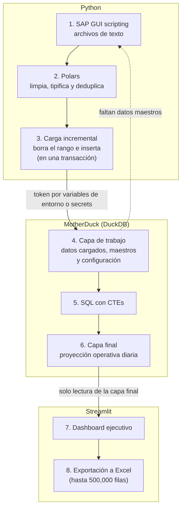

# Plataforma de datos logísticos con DuckDB / MotherDuck y Streamlit

> **Estado:** implementado, en uso por la gerencia de Non Food y Supply Chain · pendiente de validación formal
> **English version:** [README.en.md](README.en.md)

## 1. Resumen ejecutivo

Este proyecto convierte datos logísticos extraídos de SAP en una **proyección operativa diaria** para centros de distribución y la expone en un **dashboard ejecutivo**. Python y Polars extraen y limpian los datos, **MotherDuck (DuckDB en la nube)** los almacena en dos capas y **Streamlit** los consume. Hoy lo usa la gerencia de Non Food y Supply Chain; todavía no hay métricas de impacto medidas.

## 2. El Problema — El contexto

- Los datos logísticos viven en varias fuentes operativas: SAP y tablas de maestros y configuración.
- La necesidad: una proyección diaria confiable y un seguimiento claro de lo **generado frente a lo pendiente**.
- **No existía un reporte previo.** Se pensó implementarlo como una macro de VBA en Excel.
- Restricción de negocio: hay que conocer el **historial de cada pedido**, algo que un conjunto de archivos Excel no resuelve bien.

## 3. El Proceso — Cómo pensé

| Decisión | Por qué |
|---|---|
| Base de datos en lugar de una macro de VBA en Excel | Hacía falta el historial de cada pedido; una base de datos es más adecuada que archivos Excel. |
| MotherDuck | Ya conocía DuckDB. Además de funcionar como almacén de datos, permite generar dashboards con *Dives*. Planeo profundizar en *Flights*. |
| Dos capas: de trabajo y final | El dashboard solo lee la capa final; se separa el procesamiento del consumo. |
| Carga incremental por rango de fechas, en una transacción | Permite recargar un rango sin duplicar y revertir (rollback) si algo falla. |
| Detección automática de datos maestros faltantes | Si faltan maestros, el proceso los descarga de SAP y completa la capa de trabajo. |
| Token fuera del código | Se lee desde variables de entorno o *secrets*; nunca se sube al repositorio. |

## 4. La Solución — Qué resolví

1. **Extracción:** scripting de SAP GUI descarga archivos de texto (proyectado, precios y maestro de materiales).
2. **Limpieza:** Polars limpia, renombra, tipifica y deduplica los datos.
3. **Carga:** se cargan a MotherDuck de forma incremental por rango de fechas, dentro de una transacción.
4. **Modelado:** una consulta SQL con CTEs genera la tabla final de proyección operativa diaria (unidades de medida, montos, ajuste de la fecha de entrega, unidad de negocio y gerencia).
5. **Consumo:** un dashboard de Streamlit lee la tabla final y muestra KPIs, generado vs. pendiente, ritmo diario/semanal/mensual, brecha acumulada, desgloses por gerencia y unidad de negocio, filtros y exportación a Excel.

**Responsabilidades:** el pipeline de ingeniería (SAP → Polars → MotherDuck) produce los datos; el dashboard **solo consume** la capa final.

## 5. El Impacto — Resultados y evidencia

- **Uso actual:** el dashboard lo usa la gerencia de Non Food y Supply Chain. A futuro lo verán las demás gerencias, a medida que se trabajen las lógicas que necesita cada una.
- **Métricas de impacto:** aún no hay métricas confirmadas (usuarios, tiempos de ejecución, horas ahorradas).
- **Evidencia disponible:** el código de este repositorio.

> **Pendiente:** capturas del dashboard, sin datos sensibles, en `docs/img/`. No se publica un enlace a la aplicación porque muestra datos internos.

<!--


-->

## 6. Arquitectura técnica



### Componentes

| Componente | Responsabilidad |
|---|---|
| `SAP_.py` | Extracción desde SAP con scripting de SAP GUI y lectura de los archivos de texto con Polars. |
| `Auxiliar.py` | Funciones de apoyo: lectura de archivos de texto, conexión a SAP y preparación de carpetas. |
| `duckdb_queries.py` | Cargas incrementales y consultas sobre MotherDuck, con control transaccional. |
| `dashboard_.py` | Dashboard de Streamlit sobre la capa final. |

### Dependencias

`duckdb`, `polars`, `pyarrow`, `pandas`, `streamlit`, `plotly`, `python-dotenv` y `pywin32` (Windows). Las versiones exactas están fijadas en `requirements.txt`.

## 7. Calidad de datos y pruebas

**Implementado:**

- Polars limpia, renombra, tipifica y deduplica los datos antes de cargarlos.
- La carga corre dentro de una transacción (`BEGIN` / `COMMIT` / `ROLLBACK`).
- Los datos maestros faltantes se detectan y se descargan de SAP.
- El dashboard exige al menos una gerencia y una clase de documento, valida el rango de fechas y limita la exportación a 500,000 filas.

**No implementado:** no hay pruebas automatizadas en el repositorio.

**Pruebas recomendadas** (propuestas, no ejecutadas):

- Pruebas unitarias de las funciones de limpieza con archivos sintéticos.
- Verificaciones sobre la tabla final: sin duplicados por clave, sin nulos en columnas obligatorias, montos no negativos.
- Prueba de que un fallo a mitad de la carga deja intacta la capa anterior (rollback).

## 8. Estructura del repositorio

```text
rpa-ot-proyeccion/
├── .streamlit/
│   └── config.toml        # configuración de Streamlit
├── .gitignore             # excluye .env, secrets.toml, *.duckdb y *.xlsx
├── Auxiliar.py            # funciones de apoyo
├── SAP_.py                # extracción desde SAP
├── dashboard_.py          # dashboard de Streamlit
├── duckdb_queries.py      # cargas y consultas en MotherDuck
└── requirements.txt       # dependencias
```

## 9. Cómo ejecutar

> **Pendiente de verificación.** Los comandos de abajo son los previstos y no se han probado desde cero en un entorno limpio.

**Requisitos**

- **Extracción (`SAP_.py`):** Windows, SAP GUI con *scripting* habilitado y una sesión activa. No es reproducible fuera del entorno de la empresa.
- **Dashboard (`dashboard_.py`):** Python y las dependencias de `requirements.txt`. Versión de Python: por documentar.
- **Acceso a MotherDuck:** un token, en la variable `TOKEN_MOTHERDUCK`.

**Configuración**

En local, crea un archivo `.env` (ignorado por Git):

```env
TOKEN_MOTHERDUCK=<tu_token>
```

En Streamlit Cloud, define `TOKEN_MOTHERDUCK` en *Secrets*. **Nunca subas el token al repositorio.**

**Comandos previstos**

```bash
pip install -r requirements.txt
streamlit run dashboard_.py
```

## 10. Limitaciones y mejoras futuras

| Limitación | Mejora propuesta |
|---|---|
| La extracción depende de SAP GUI en Windows. | Documentar el formato de los archivos de entrada y crear datos sintéticos de demostración. |
| Sin README con instrucciones verificadas hasta ahora. | Verificar el procedimiento en un entorno limpio (sección 9). |
| Sin pruebas automatizadas. | Añadir las pruebas de la sección 7. |
| No se ve un mecanismo de programación de la carga en el código. | Evaluar *Flights* de MotherDuck para las etapas posteriores a la extracción. La extracción con SAP GUI necesita una sesión de Windows, por lo que no podría moverse allí. |
| Una ruta absoluta de Windows está fijada en el código de apoyo. | Moverla a configuración o a una variable de entorno. |
| Nombres internos de la empresa en el código. | Revisarlos antes de promocionar el repositorio. |
| Sin métricas de impacto. | Medir uso y tiempos de ejecución. |

## Estado de las funcionalidades

| Funcionalidad | Estado |
|---|---|
| Extracción desde SAP con SAP GUI | Implementado, pendiente de validación |
| Limpieza y deduplicación con Polars | Implementado, pendiente de validación |
| Carga incremental a MotherDuck en transacción | Implementado, pendiente de validación |
| Tabla final con CTEs | Implementado, pendiente de validación |
| Dashboard de Streamlit | Implementado, en uso por Non Food y Supply Chain |
| Lógicas para las demás gerencias | En desarrollo |
| Programación automática de la carga | No confirmado |
| Pruebas automatizadas | Propuesto / futuro |
| MotherDuck *Flights* | Propuesto / futuro (en aprendizaje) |
